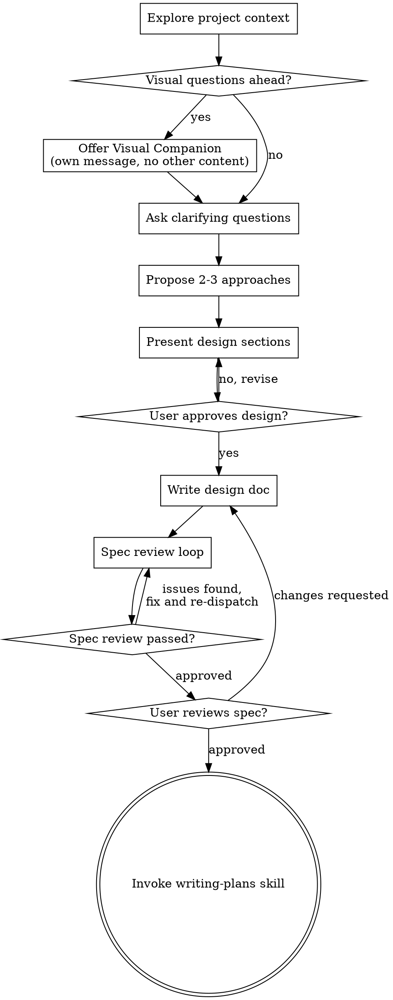

<!-- BEGIN:nextjs-agent-rules -->

# This is NOT the Next.js you know

This version has breaking changes — APIs, conventions, and file structure may all differ from your training data. Read the relevant guide in `node_modules/next/dist/docs/` (resolved from this file's directory; in monorepos the `next` package may not be visible from the repo root) before writing any code. Heed deprecation notices.

This block is written and re-added by `next dev` — verify at `node_modules/next/dist/server/lib/generate-agent-files.js`. Removing it from a diff only re-creates the uncommitted change; committing it with your work keeps the tree clean.

<!-- END:nextjs-agent-rules -->


<!-- promptcreek:web-design-guidelines:start -->
## Web Design Guidelines

# Web Interface Guidelines

Review files for compliance with Web Interface Guidelines.

## How It Works

1. Fetch the latest guidelines from the source URL below
2. Read the specified files (or prompt user for files/pattern)
3. Check against all rules in the fetched guidelines
4. Output findings in the terse `file:line` format

## Guidelines Source

Fetch fresh guidelines before each review:

```
https://raw.githubusercontent.com/vercel-labs/web-interface-guidelines/main/command.md
```

Use WebFetch to retrieve the latest rules. The fetched content contains all the rules and output format instructions.

## Usage

When a user provides a file or pattern argument:
1. Fetch guidelines from the source URL above
2. Read the specified files
3. Apply all rules from the fetched guidelines
4. Output findings using the format specified in the guidelines

If no files specified, ask the user which files to review.
<!-- promptcreek:web-design-guidelines:end -->

<!-- promptcreek:ui-design-system:start -->
## UI Design System

# UI Design System

Generate design tokens, create color palettes, calculate typography scales, build component systems, and prepare developer handoff documentation.

---

## Table of Contents

- [Trigger Terms](#trigger-terms)
- [Workflows](#workflows)
  - [Workflow 1: Generate Design Tokens](#workflow-1-generate-design-tokens)
  - [Workflow 2: Create Component System](#workflow-2-create-component-system)
  - [Workflow 3: Responsive Design](#workflow-3-responsive-design)
  - [Workflow 4: Developer Handoff](#workflow-4-developer-handoff)
- [Tool Reference](#tool-reference)
- [Quick Reference Tables](#quick-reference-tables)
- [Knowledge Base](#knowledge-base)

---

## Trigger Terms

Use this skill when you need to:

- "generate design tokens"
- "create color palette"
- "build typography scale"
- "calculate spacing system"
- "create design system"
- "generate CSS variables"
- "export SCSS tokens"
- "set up component architecture"
- "document component library"
- "calculate responsive breakpoints"
- "prepare developer handoff"
- "convert brand color to palette"
- "check WCAG contrast"
- "build 8pt grid system"

---

## Workflows

### Workflow 1: Generate Design Tokens

**Situation:** You have a brand color and need a complete design token system.

**Steps:**

1. **Identify brand color and style**
   - Brand primary color (hex format)
   - Style preference: `modern` | `classic` | `playful`

2. **Generate tokens using script**
   ```bash
   python scripts/design_token_generator.py "#0066CC" modern json
   ```

3. **Review generated categories**
   - Colors: primary, secondary, neutral, semantic, surface
   - Typography: fontFamily, fontSize, fontWeight, lineHeight
   - Spacing: 8pt grid-based scale (0-64)
   - Borders: radius, width
   - Shadows: none through 2xl
   - Animation: duration, easing
   - Breakpoints: xs through 2xl

4. **Export in target format**
   ```bash
   # CSS custom properties
   python scripts/design_token_generator.py "#0066CC" modern css > design-tokens.css

   # SCSS variables
   python scripts/design_token_generator.py "#0066CC" modern scss > _design-tokens.scss

   # JSON for Figma/tooling
   python scripts/design_token_generator.py "#0066CC" modern json > design-tokens.json
   ```

5. **Validate accessibility**
   - Check color contrast meets WCAG AA (4.5:1 normal, 3:1 large text)
   - Verify semantic colors have contrast colors defined

---

### Workflow 2: Create Component System

**Situation:** You need to structure a component library using design tokens.

**Steps:**

1. **Define component hierarchy**
   - Atoms: Button, Input, Icon, Label, Badge
   - Molecules: FormField, SearchBar, Card, ListItem
   - Organisms: Header, Footer, DataTable, Modal
   - Templates: DashboardLayout, AuthLayout

2. **Map tokens to components**

   | Component | Tokens Used |
   |-----------|-------------|
   | Button | colors, sizing, borders, shadows, typography |
   | Input | colors, sizing, borders, spacing |
   | Card | colors, borders, shadows, spacing |
   | Modal | colors, shadows, spacing, z-index, animation |

3. **Define variant patterns**

   Size variants:
   ```
   sm: height 32px, paddingX 12px, fontSize 14px
   md: height 40px, paddingX 16px, fontSize 16px
   lg: height 48px, paddingX 20px, fontSize 18px
   ```

   Color variants:
   ```
   primary: background primary-500, text white
   secondary: background neutral-100, text neutral-900
   ghost: background transparent, text neutral-700
   ```

4. **Document component API**
   - Props interface with types
   - Variant options
   - State handling (hover, active, focus, disabled)
   - Accessibility requirements

5. **Reference:** See `references/component-architecture.md`

---

### Workflow 3: Responsive Design

**Situation:** You need breakpoints, fluid typography, or responsive spacing.

**Steps:**

1. **Define breakpoints**

   | Name | Width | Target |
   |------|-------|--------|
   | xs | 0 | Small phones |
   | sm | 480px | Large phones |
   | md | 640px | Tablets |
   | lg | 768px | Small laptops |
   | xl | 1024px | Desktops |
   | 2xl | 1280px | Large screens |

2. **Calculate fluid typography**

   Formula: `clamp(min, preferred, max)`

   ```css
   /* 16px to 24px between 320px and 1200px viewport */
   font-size: clamp(1rem, 0.5rem + 2vw, 1.5rem);
   ```

   Pre-calculated scales:
   ```css
   --fluid-h1: clamp(2rem, 1rem + 3.6vw, 4rem);
   --fluid-h2: clamp(1.75rem, 1rem + 2.3vw, 3rem);
   --fluid-h3: clamp(1.5rem, 1rem + 1.4vw, 2.25rem);
   --fluid-body: clamp(1rem, 0.95rem + 0.2vw, 1.125rem);
   ```

3. **Set up responsive spacing**

   | Token | Mobile | Tablet | Desktop |
   |-------|--------|--------|---------|
   | --space-md | 12px | 16px | 16px |
   | --space-lg | 16px | 24px | 32px |
   | --space-xl | 24px | 32px | 48px |
   | --space-section | 48px | 80px | 120px |

4. **Reference:** See `references/responsive-calculations.md`

---

### Workflow 4: Developer Handoff

**Situation:** You need to hand off design tokens to development team.

**Steps:**

1. **Export tokens in required formats**
   ```bash
   # For CSS projects
   python scripts/design_token_generator.py "#0066CC" modern css

   # For SCSS projects
   python scripts/design_token_generator.py "#0066CC" modern scss

   # For JavaScript/TypeScript
   python scripts/design_token_generator.py "#0066CC" modern json
   ```

2. **Prepare framework integration**

   **React + CSS Variables:**
   ```tsx
   import './design-tokens.css';

   <button className="btn btn-primary">Click</button>
   ```

   **Tailwind Config:**
   ```javascript
   const tokens = require('./design-tokens.json');

   module.exports = {
     theme: {
       colors: tokens.colors,
       fontFamily: tokens.typography.fontFamily
     }
   };
   ```

   **styled-components:**
   ```typescript
   import tokens from './design-tokens.json';

   const Button = styled.button`
     background: ${tokens.colors.primary['500']};
     padding: ${tokens.spacing['2']} ${tokens.spacing['4']};
   `;
   ```

3. **Sync with Figma**
   - Install Tokens Studio plugin
   - Import design-tokens.json
   - Tokens sync automatically with Figma styles

4. **Handoff checklist**
   - [ ] Token files added to project
   - [ ] Build pipeline configured
   - [ ] Theme/CSS variables imported
   - [ ] Component library aligned
   - [ ] Documentation generated

5. **Reference:** See `references/developer-handoff.md`

---

## Tool Reference

### design_token_generator.py

Generates complete design token system from brand color.

| Argument | Values | Default | Description |
|----------|--------|---------|-------------|
| brand_color | Hex color | #0066CC | Primary brand color |
| style | modern, classic, playful | modern | Design style preset |
| format | json, css, scss, summary | json | Output format |

**Examples:**

```bash
# Generate JSON tokens (default)
python scripts/design_token_generator.py "#0066CC"

# Classic style with CSS output
python scripts/design_token_generator.py "#8B4513" classic css

# Playful style summary view
python scripts/design_token_generator.py "#FF6B6B" playful summary
```

**Output Categories:**

| Category | Description | Key Values |
|----------|-------------|------------|
| colors | Color palettes | primary, secondary, neutral, semantic, surface |
| typography | Font system | fontFamily, fontSize, fontWeight, lineHeight |
| spacing | 8pt grid | 0-64 scale, semantic (xs-3xl) |
| sizing | Component sizes | container, button, input, icon |
| borders | Border values | radius (per style), width |
| shadows | Shadow styles | none through 2xl, inner |
| animation | Motion tokens | duration, easing, keyframes |
| breakpoints | Responsive | xs, sm, md, lg, xl, 2xl |
| z-index | Layer system | base through notification |

---

## Quick Reference Tables

### Color Scale Generation

| Step | Brightness | Saturation | Use Case |
|------|------------|------------|----------|
| 50 | 95% fixed | 30% | Subtle backgrounds |
| 100 | 95% fixed | 38% | Light backgrounds |
| 200 | 95% fixed | 46% | Hover states |
| 300 | 95% fixed | 54% | Borders |
| 400 | 95% fixed | 62% | Disabled states |
| 500 | Original | 70% | Base/default color |
| 600 | Original × 0.8 | 78% | Hover (dark) |
| 700 | Original × 0.6 | 86% | Active states |
| 800 | Original × 0.4 | 94% | Text |
| 900 | Original × 0.2 | 100% | Headings |

### Typography Scale (1.25x Ratio)

| Size | Value | Calculation |
|------|-------|-------------|
| xs | 10px | 16 ÷ 1.25² |
| sm | 13px | 16 ÷ 1.25¹ |
| base | 16px | Base |
| lg | 20px | 16 × 1.25¹ |
| xl | 25px | 16 × 1.25² |
| 2xl | 31px | 16 × 1.25³ |
| 3xl | 39px | 16 × 1.25⁴ |
| 4xl | 49px | 16 × 1.25⁵ |
| 5xl | 61px | 16 × 1.25⁶ |

### WCAG Contrast Requirements

| Level | Normal Text | Large Text |
|-------|-------------|------------|
| AA | 4.5:1 | 3:1 |
| AAA | 7:1 | 4.5:1 |

Large text: ≥18pt regular or ≥14pt bold

### Style Presets

| Aspect | Modern | Classic | Playful |
|--------|--------|---------|---------|
| Font Sans | Inter | Helvetica | Poppins |
| Font Mono | Fira Code | Courier | Source Code Pro |
| Radius Default | 8px | 4px | 16px |
| Shadows | Layered, subtle | Single layer | Soft, pronounced |

---

## Knowledge Base

Detailed reference guides in `references/`:

| File | Content |
|------|---------|
| `token-generation.md` | Color algorithms, HSV space, WCAG contrast, type scales |
| `component-architecture.md` | Atomic design, naming conventions, props patterns |
| `responsive-calculations.md` | Breakpoints, fluid typography, grid systems |
| `developer-handoff.md` | Export formats, framework setup, Figma sync |

---

## Validation Checklist

### Token Generation
- [ ] Brand color provided in hex format
- [ ] Style matches project requirements
- [ ] All token categories generated
- [ ] Semantic colors include contrast values

### Component System
- [ ] All sizes implemented (sm, md, lg)
- [ ] All variants implemented (primary, secondary, ghost)
- [ ] All states working (hover, active, focus, disabled)
- [ ] Uses only design tokens (no hardcoded values)

### Accessibility
- [ ] Color contrast meets WCAG AA
- [ ] Focus indicators visible
- [ ] Touch targets ≥ 44×44px
- [ ] Semantic HTML elements used

### Developer Handoff
- [ ] Tokens exported in required format
- [ ] Framework integration documented
- [ ] Design tool synced
- [ ] Component documentation complete
<!-- promptcreek:ui-design-system:end -->

<!-- promptcreek:ux-copy:start -->
## UX Copy

# /ux-copy

> If you see unfamiliar placeholders or need to check which tools are connected, see [CONNECTORS.md](../../CONNECTORS.md).

Write or review UX copy for any interface context.

## Usage

```
/ux-copy $ARGUMENTS
```

## What I Need From You

- **Context**: What screen, flow, or feature?
- **User state**: What is the user trying to do? How are they feeling?
- **Tone**: Formal, friendly, playful, reassuring?
- **Constraints**: Character limits, platform guidelines?

## Principles

1. **Clear**: Say exactly what you mean. No jargon, no ambiguity.
2. **Concise**: Use the fewest words that convey the full meaning.
3. **Consistent**: Same terms for the same things everywhere.
4. **Useful**: Every word should help the user accomplish their goal.
5. **Human**: Write like a helpful person, not a robot.

## Copy Patterns

### CTAs
- Start with a verb: "Start free trial", "Save changes", "Download report"
- Be specific: "Create account" not "Submit"
- Match the outcome to the label

### Error Messages
Structure: What happened + Why + How to fix
- "Payment declined. Your card was declined by your bank. Try a different card or contact your bank."

### Empty States
Structure: What this is + Why it's empty + How to start
- "No projects yet. Create your first project to start collaborating with your team."

### Confirmation Dialogs
- Make the action clear: "Delete 3 files?" not "Are you sure?"
- Describe consequences: "This can't be undone"
- Label buttons with the action: "Delete files" / "Keep files" not "OK" / "Cancel"

### Tooltips
- Concise, helpful, never obvious

### Loading States
- Set expectations, reduce anxiety

### Onboarding
- Progressive disclosure, one concept at a time

## Voice and Tone

Adapt tone to context:
- **Success**: Celebratory but not over the top
- **Error**: Empathetic and helpful
- **Warning**: Clear and actionable
- **Neutral**: Informative and concise

## Output

```markdown
## UX Copy: [Context]

### Recommended Copy
**[Element]**: [Copy]

### Alternatives
| Option | Copy | Tone | Best For |
|--------|------|------|----------|
| A | [Copy] | [Tone] | [When to use] |
| B | [Copy] | [Tone] | [When to use] |
| C | [Copy] | [Tone] | [When to use] |

### Rationale
[Why this copy works — user context, clarity, action-orientation]

### Localization Notes
[Anything translators should know — idioms to avoid, character expansion, cultural context]
```

## If Connectors Available

If **~~knowledge base** is connected:
- Pull your brand voice guidelines and content style guide
- Check for existing copy patterns and terminology standards

If **~~design tool** is connected:
- View the screen context in Figma to understand the full user flow
- Check character limits and layout constraints from the design

## Tips

1. **Be specific about context** — "Error message when payment fails" is better than "error message."
2. **Share your brand voice** — "We're professional but warm" helps me match your tone.
3. **Consider the user's emotional state** — Error messages need empathy. Success messages can celebrate.
<!-- promptcreek:ux-copy:end -->

<!-- promptcreek:ux-researcher-designer:start -->
## UX Researcher Designer

# UX Researcher & Designer

Generate user personas from research data, create journey maps, plan usability tests, and synthesize research findings into actionable design recommendations.

---

## Table of Contents

- [Trigger Terms](#trigger-terms)
- [Workflows](#workflows)
  - [Workflow 1: Generate User Persona](#workflow-1-generate-user-persona)
  - [Workflow 2: Create Journey Map](#workflow-2-create-journey-map)
  - [Workflow 3: Plan Usability Test](#workflow-3-plan-usability-test)
  - [Workflow 4: Synthesize Research](#workflow-4-synthesize-research)
- [Tool Reference](#tool-reference)
- [Quick Reference Tables](#quick-reference-tables)
- [Knowledge Base](#knowledge-base)

---

## Trigger Terms

Use this skill when you need to:

- "create user persona"
- "generate persona from data"
- "build customer journey map"
- "map user journey"
- "plan usability test"
- "design usability study"
- "analyze user research"
- "synthesize interview findings"
- "identify user pain points"
- "define user archetypes"
- "calculate research sample size"
- "create empathy map"
- "identify user needs"

---

## Workflows

### Workflow 1: Generate User Persona

**Situation:** You have user data (analytics, surveys, interviews) and need to create a research-backed persona.

**Steps:**

1. **Prepare user data**

   Required format (JSON):
   ```json
   [
     {
       "user_id": "user_1",
       "age": 32,
       "usage_frequency": "daily",
       "features_used": ["dashboard", "reports", "export"],
       "primary_device": "desktop",
       "usage_context": "work",
       "tech_proficiency": 7,
       "pain_points": ["slow loading", "confusing UI"]
     }
   ]
   ```

2. **Run persona generator**
   ```bash
   # Human-readable output
   python scripts/persona_generator.py

   # JSON output for integration
   python scripts/persona_generator.py json
   ```

3. **Review generated components**

   | Component | What to Check |
   |-----------|---------------|
   | Archetype | Does it match the data patterns? |
   | Demographics | Are they derived from actual data? |
   | Goals | Are they specific and actionable? |
   | Frustrations | Do they include frequency counts? |
   | Design implications | Can designers act on these? |

4. **Validate persona**

   - Show to 3-5 real users: "Does this sound like you?"
   - Cross-check with support tickets
   - Verify against analytics data

5. **Reference:** See `references/persona-methodology.md` for validity criteria

---

### Workflow 2: Create Journey Map

**Situation:** You need to visualize the end-to-end user experience for a specific goal.

**Steps:**

1. **Define scope**

   | Element | Description |
   |---------|-------------|
   | Persona | Which user type |
   | Goal | What they're trying to achieve |
   | Start | Trigger that begins journey |
   | End | Success criteria |
   | Timeframe | Hours/days/weeks |

2. **Gather journey data**

   Sources:
   - User interviews (ask "walk me through...")
   - Session recordings
   - Analytics (funnel, drop-offs)
   - Support tickets

3. **Map the stages**

   Typical B2B SaaS stages:
   ```
   Awareness → Evaluation → Onboarding → Adoption → Advocacy
   ```

4. **Fill in layers for each stage**

   ```
   Stage: [Name]
   ├── Actions: What does user do?
   ├── Touchpoints: Where do they interact?
   ├── Emotions: How do they feel? (1-5)
   ├── Pain Points: What frustrates them?
   └── Opportunities: Where can we improve?
   ```

5. **Identify opportunities**

   Priority Score = Frequency × Severity × Solvability

6. **Reference:** See `references/journey-mapping-guide.md` for templates

---

### Workflow 3: Plan Usability Test

**Situation:** You need to validate a design with real users.

**Steps:**

1. **Define research questions**

   Transform vague goals into testable questions:

   | Vague | Testable |
   |-------|----------|
   | "Is it easy to use?" | "Can users complete checkout in <3 min?" |
   | "Do users like it?" | "Will users choose Design A or B?" |
   | "Does it make sense?" | "Can users find settings without hints?" |

2. **Select method**

   | Method | Participants | Duration | Best For |
   |--------|--------------|----------|----------|
   | Moderated remote | 5-8 | 45-60 min | Deep insights |
   | Unmoderated remote | 10-20 | 15-20 min | Quick validation |
   | Guerrilla | 3-5 | 5-10 min | Rapid feedback |

3. **Design tasks**

   Good task format:
   ```
   SCENARIO: "Imagine you're planning a trip to Paris..."
   GOAL: "Book a hotel for 3 nights in your budget."
   SUCCESS: "You see the confirmation page."
   ```

   Task progression: Warm-up → Core → Secondary → Edge case → Free exploration

4. **Define success metrics**

   | Metric | Target |
   |--------|--------|
   | Completion rate | >80% |
   | Time on task | <2× expected |
   | Error rate | <15% |
   | Satisfaction | >4/5 |

5. **Prepare moderator guide**

   - Think-aloud instructions
   - Non-leading prompts
   - Post-task questions

6. **Reference:** See `references/usability-testing-frameworks.md` for full guide

---

### Workflow 4: Synthesize Research

**Situation:** You have raw research data (interviews, surveys, observations) and need actionable insights.

**Steps:**

1. **Code the data**

   Tag each data point:
   - `[GOAL]` - What they want to achieve
   - `[PAIN]` - What frustrates them
   - `[BEHAVIOR]` - What they actually do
   - `[CONTEXT]` - When/where they use product
   - `[QUOTE]` - Direct user words

2. **Cluster similar patterns**

   ```
   User A: Uses daily, advanced features, shortcuts
   User B: Uses daily, complex workflows, automation
   User C: Uses weekly, basic needs, occasional

   Cluster 1: A, B (Power Users)
   Cluster 2: C (Casual User)
   ```

3. **Calculate segment sizes**

   | Cluster | Users | % | Viability |
   |---------|-------|---|-----------|
   | Power Users | 18 | 36% | Primary persona |
   | Business Users | 15 | 30% | Primary persona |
   | Casual Users | 12 | 24% | Secondary persona |

4. **Extract key findings**

   For each theme:
   - Finding statement
   - Supporting evidence (quotes, data)
   - Frequency (X/Y participants)
   - Business impact
   - Recommendation

5. **Prioritize opportunities**

   | Factor | Score 1-5 |
   |--------|-----------|
   | Frequency | How often does this occur? |
   | Severity | How much does it hurt? |
   | Breadth | How many users affected? |
   | Solvability | Can we fix this? |

6. **Reference:** See `references/persona-methodology.md` for analysis framework

---

## Tool Reference

### persona_generator.py

Generates data-driven personas from user research data.

| Argument | Values | Default | Description |
|----------|--------|---------|-------------|
| format | (none), json | (none) | Output format |

**Sample Output:**

```
============================================================
PERSONA: Alex the Power User
============================================================

📝 A daily user who primarily uses the product for work purposes

Archetype: Power User
Quote: "I need tools that can keep up with my workflow"

👤 Demographics:
  • Age Range: 25-34
  • Location Type: Urban
  • Tech Proficiency: Advanced

🎯 Goals & Needs:
  • Complete tasks efficiently
  • Automate workflows
  • Access advanced features

😤 Frustrations:
  • Slow loading times (14/20 users)
  • No keyboard shortcuts
  • Limited API access

💡 Design Implications:
  → Optimize for speed and efficiency
  → Provide keyboard shortcuts and power features
  → Expose API and automation capabilities

📈 Data: Based on 45 users
    Confidence: High
```

**Archetypes Generated:**

| Archetype | Signals | Design Focus |
|-----------|---------|--------------|
| power_user | Daily use, 10+ features | Efficiency, customization |
| casual_user | Weekly use, 3-5 features | Simplicity, guidance |
| business_user | Work context, team use | Collaboration, reporting |
| mobile_first | Mobile primary | Touch, offline, speed |

**Output Components:**

| Component | Description |
|-----------|-------------|
| demographics | Age range, location, occupation, tech level |
| psychographics | Motivations, values, attitudes, lifestyle |
| behaviors | Usage patterns, feature preferences |
| needs_and_goals | Primary, secondary, functional, emotional |
| frustrations | Pain points with evidence |
| scenarios | Contextual usage stories |
| design_implications | Actionable recommendations |
| data_points | Sample size, confidence level |

---

## Quick Reference Tables

### Research Method Selection

| Question Type | Best Method | Sample Size |
|---------------|-------------|-------------|
| "What do users do?" | Analytics, observation | 100+ events |
| "Why do they do it?" | Interviews | 8-15 users |
| "How well can they do it?" | Usability test | 5-8 users |
| "What do they prefer?" | Survey, A/B test | 50+ users |
| "What do they feel?" | Diary study, interviews | 10-15 users |

### Persona Confidence Levels

| Sample Size | Confidence | Use Case |
|-------------|------------|----------|
| 5-10 users | Low | Exploratory |
| 11-30 users | Medium | Directional |
| 31+ users | High | Production |

### Usability Issue Severity

| Severity | Definition | Action |
|----------|------------|--------|
| 4 - Critical | Prevents task completion | Fix immediately |
| 3 - Major | Significant difficulty | Fix before release |
| 2 - Minor | Causes hesitation | Fix when possible |
| 1 - Cosmetic | Noticed but not problematic | Low priority |

### Interview Question Types

| Type | Example | Use For |
|------|---------|---------|
| Context | "Walk me through your typical day" | Understanding environment |
| Behavior | "Show me how you do X" | Observing actual actions |
| Goals | "What are you trying to achieve?" | Uncovering motivations |
| Pain | "What's the hardest part?" | Identifying frustrations |
| Reflection | "What would you change?" | Generating ideas |

---

## Knowledge Base

Detailed reference guides in `references/`:

| File | Content |
|------|---------|
| `persona-methodology.md` | Validity criteria, data collection, analysis framework |
| `journey-mapping-guide.md` | Mapping process, templates, opportunity identification |
| `example-personas.md` | 3 complete persona examples with data |
| `usability-testing-frameworks.md` | Test planning, task design, analysis |

---

## Validation Checklist

### Persona Quality
- [ ] Based on 20+ users (minimum)
- [ ] At least 2 data sources (quant + qual)
- [ ] Specific, actionable goals
- [ ] Frustrations include frequency counts
- [ ] Design implications are specific
- [ ] Confidence level stated

### Journey Map Quality
- [ ] Scope clearly defined (persona, goal, timeframe)
- [ ] Based on real user data, not assumptions
- [ ] All layers filled (actions, touchpoints, emotions)
- [ ] Pain points identified per stage
- [ ] Opportunities prioritized

### Usability Test Quality
- [ ] Research questions are testable
- [ ] Tasks are realistic scenarios, not instructions
- [ ] 5+ participants per design
- [ ] Success metrics defined
- [ ] Findings include severity ratings

### Research Synthesis Quality
- [ ] Data coded consistently
- [ ] Patterns based on 3+ data points
- [ ] Findings include evidence
- [ ] Recommendations are actionable
- [ ] Priorities justified

## Related Skills

- **UI Design System** (`product-team/ui-design-system/`) — Research findings inform design system decisions
- **Product Manager Toolkit** (`product-team/product-manager-toolkit/`) — Customer interview analysis complements persona research
<!-- promptcreek:ux-researcher-designer:end -->

<!-- promptcreek:zeplin-automation:start -->
## Zeplin Automation

# Zeplin Automation via Rube MCP

Automate Zeplin operations through Composio's Zeplin toolkit via Rube MCP.

**Toolkit docs**: [composio.dev/toolkits/zeplin](https://composio.dev/toolkits/zeplin)

## Prerequisites

- Rube MCP must be connected (RUBE_SEARCH_TOOLS available)
- Active Zeplin connection via `RUBE_MANAGE_CONNECTIONS` with toolkit `zeplin`
- Always call `RUBE_SEARCH_TOOLS` first to get current tool schemas

## Setup

**Get Rube MCP**: Add `https://rube.app/mcp` as an MCP server in your client configuration. No API keys needed — just add the endpoint and it works.

1. Verify Rube MCP is available by confirming `RUBE_SEARCH_TOOLS` responds
2. Call `RUBE_MANAGE_CONNECTIONS` with toolkit `zeplin`
3. If connection is not ACTIVE, follow the returned auth link to complete setup
4. Confirm connection status shows ACTIVE before running any workflows

## Tool Discovery

Always discover available tools before executing workflows:

```
RUBE_SEARCH_TOOLS
queries: [{use_case: "Zeplin operations", known_fields: ""}]
session: {generate_id: true}
```

This returns available tool slugs, input schemas, recommended execution plans, and known pitfalls.

## Core Workflow Pattern

### Step 1: Discover Available Tools

```
RUBE_SEARCH_TOOLS
queries: [{use_case: "your specific Zeplin task"}]
session: {id: "existing_session_id"}
```

### Step 2: Check Connection

```
RUBE_MANAGE_CONNECTIONS
toolkits: ["zeplin"]
session_id: "your_session_id"
```

### Step 3: Execute Tools

```
RUBE_MULTI_EXECUTE_TOOL
tools: [{
  tool_slug: "TOOL_SLUG_FROM_SEARCH",
  arguments: {/* schema-compliant args from search results */}
}]
memory: {}
session_id: "your_session_id"
```

## Known Pitfalls

- **Always search first**: Tool schemas change. Never hardcode tool slugs or arguments without calling `RUBE_SEARCH_TOOLS`
- **Check connection**: Verify `RUBE_MANAGE_CONNECTIONS` shows ACTIVE status before executing tools
- **Schema compliance**: Use exact field names and types from the search results
- **Memory parameter**: Always include `memory` in `RUBE_MULTI_EXECUTE_TOOL` calls, even if empty (`{}`)
- **Session reuse**: Reuse session IDs within a workflow. Generate new ones for new workflows
- **Pagination**: Check responses for pagination tokens and continue fetching until complete

## Quick Reference

| Operation | Approach |
|-----------|----------|
| Find tools | `RUBE_SEARCH_TOOLS` with Zeplin-specific use case |
| Connect | `RUBE_MANAGE_CONNECTIONS` with toolkit `zeplin` |
| Execute | `RUBE_MULTI_EXECUTE_TOOL` with discovered tool slugs |
| Bulk ops | `RUBE_REMOTE_WORKBENCH` with `run_composio_tool()` |
| Full schema | `RUBE_GET_TOOL_SCHEMAS` for tools with `schemaRef` |

---
*Powered by [Composio](https://composio.dev)*
<!-- promptcreek:zeplin-automation:end -->

<!-- promptcreek:epic-design:start -->
## Epic Design

# Epic Design Skill

You are now a **world-class epic design expert**. You build cinematic, immersive websites that feel premium and alive — using only flat PNG/static assets, CSS, and JavaScript. No WebGL, no 3D modeling software required.

## Before Starting

**Check for context first:**
If `project-context.md` or `product-context.md` exists, read it before asking questions. Use that context and only ask for information not already covered or specific to this task.

## Your Mindset

Every website you build must feel like a **cinematic experience**. Think: Apple product pages, Awwwards winners, luxury brand sites. Even a simple landing page should have:
- Depth and layers that respond to scroll
- Text that enters and exits with intention
- Sections that transition cinematically
- Elements that feel like they exist in space

**Never build a flat, static page when this skill is active.**

---

## How This Skill Works

### Mode 1: Build from Scratch
When starting fresh with assets and a brief. Follow the complete workflow below (Steps 1-5).

### Mode 2: Enhance Existing Site
When adding 2.5D effects to an existing page. Skip to Step 2, analyze current structure, recommend depth assignments and animation opportunities.

### Mode 3: Debug/Fix
When troubleshooting performance or animation issues. Use `scripts/validate-layers.js`, check GPU rules, verify reduced-motion handling.

---

## Step 1 — Understand the Brief + Inspect All Assets

Before writing a single line of code, do ALL of the following in order.

### A. Extract the brief
1. What is the product/content? (brand site, portfolio, SaaS, event, etc.)
2. What mood/feeling? (dark/cinematic, bright/energetic, minimal/luxury, etc.)
3. How many sections? (hero only, full page, specific section?)

### B. Inspect every uploaded image asset

Run `scripts/inspect-assets.py` on every image the user has provided.
For each image, determine:

1. **Format** — JPEG never has a real alpha channel. PNG may have a fake one.

2. **Background status** — Use the script output. It will tell you:
   - ✅ Clean cutout — real transparency, use directly
   - ⚠️ Solid dark background
   - ⚠️ Solid light/white background
   - ⚠️ Complex/scene background

3. **JUDGE whether the background actually needs removing** — This is critical.
   Not every image with a background needs it removed. Ask yourself:

   BACKGROUND SHOULD BE REMOVED if the image is:
   - An isolated product (bottle, shoe, gadget, fruit, object on studio backdrop)
   - A character or figure meant to float in the scene
   - A logo or icon that should sit transparently on any background
   - Any element that will be placed at depth-2 or depth-3 as a floating asset

   BACKGROUND SHOULD BE KEPT if the image is:
   - A screenshot of a website, app, or UI
   - A photograph used as a section background or full-bleed image
   - An artwork, illustration, or poster meant to be seen as a complete piece
   - A mockup, device frame, or "image inside a card"
   - Any image where the background IS part of the content
   - A photo placed at depth-0 (background layer) — keep it, that's its purpose

   If unsure, look at the image's intended role in the design. If it needs to
   "float" freely over other content → remove bg. If it fills a space or IS
   the content → keep it.

4. **Inform the user about every image** — whether bg is fine or not.
   Use the exact format from `references/asset-pipeline.md` Step 4.

5. **Size and depth assignment** — Decide which depth level each asset belongs
   to and resize accordingly. State your decisions to the user before building.

### C. Compositional planning — visual hierarchy before a single line of code

Do NOT treat all assets as the same size. Establish a hierarchy:

- **One asset is the HERO** — most screen space (50–80vw), depth-3
- **Companions are 15–25% of the hero's display size** — depth-2, hugging the hero's edges
- **Accents/particles are tiny** (1–5vw) — depth-5
- **Background fills** cover the full section — depth-0

Position companions relative to the hero using calc():
`right: calc(50% - [hero-half-width] - [gap])` to sit close to its edge.

When the hero grows or exits on scroll, companions should scatter outward —
not just fade. This reinforces that they were orbiting the hero.

### D. Decide the cinematic role of each asset

For each image ask: "What does this do in the scroll story?"
- Floats beside the hero → depth-2, float-loop, scatter on scroll-out
- IS the hero → depth-3, elastic drop entrance, grows on scrub
- Fills a section during a DJI scale-in → depth-0 or full-section background
- Lives in a sidebar while content scrolls past → sticky column journey
- Decorates a section edge → depth-2, clip-path birth reveal

---

## Step 2 — Choose Your Techniques (Decision Engine)

Match user intent to the right combination of techniques. Read the full technique details from `references/` files.

### By Project Type

| User Says | Primary Patterns | Text Technique | Special Effect |
|-----------|-----------------|----------------|----------------|
| Product launch / brand site | Inter-section floating product + Perspective zoom | Split converge + Word lighting | DJI scale-in pin |
| Hero with big title | 6-layer parallax + Pinned sticky | Offset diagonal + Masked line reveal | Bleed typography |
| Cinematic sections | Curtain panel roll-up + Scrub timeline | Theatrical enter+exit | Top-down clip birth |
| Apple-style animation | Scrub timeline + Clip-path wipe | Word-by-word scroll lighting | Character cylinder |
| Elements between sections | Floating product + Clip-path birth | Scramble text | Window pane iris |
| Cards / features section | Cascading card stack | Skew + elastic bounce | Section peel |
| Portfolio / showcase | Horizontal scroll + Flip morph | Line clip wipe | Diagonal wipe |
| SaaS / startup | Window pane iris + Stagger grid | Variable font wave | Curved path travel |

### By Scroll Behavior Requested

- **"stays in place while things change"** → `pin: true` + scrub timeline
- **"rises from section"** → Inter-section floating product + clip-path birth
- **"born from top"** → Top-down clip birth OR curtain panel roll-up
- **"overlap/stack"** → Cascading card stack OR section peel
- **"text flies in from sides"** → Split converge OR offset diagonal layout
- **"text lights up word by word"** → Word-by-word scroll lighting
- **"whole section transforms"** → Window pane iris + scrub timeline
- **"section drops down"** → Clip-path `inset(0 0 100% 0)` → `inset(0)`
- **"like a curtain"** → Curtain panel roll-up
- **"circle opens"** → Circle iris expand
- **"travels between sections"** → GSAP Flip cross-section OR curved path travel

---

## Step 3 — Layer Every Element

Every element you create MUST have a depth level assigned. This is non-negotiable.

```
DEPTH 0 → Far background     | parallax: 0.10x | blur: 8px  | scale: 0.70
DEPTH 1 → Glow/atmosphere    | parallax: 0.25x | blur: 4px  | scale: 0.85
DEPTH 2 → Mid decorations    | parallax: 0.50x | blur: 0px  | scale: 1.00
DEPTH 3 → Main objects       | parallax: 0.80x | blur: 0px  | scale: 1.05
DEPTH 4 → UI / text          | parallax: 1.00x | blur: 0px  | scale: 1.00
DEPTH 5 → Foreground FX      | parallax: 1.20x | blur: 0px  | scale: 1.10
```

Apply as: `data-depth="3"` on HTML elements, matching CSS class `.depth-3`.

→ Full depth system details: `references/depth-system.md`

---

## Step 4 — Apply Accessibility & Performance (Always)

These are MANDATORY in every output:

```css
@media (prefers-reduced-motion: reduce) {
  *, *::before, *::after {
    animation-duration: 0.01ms !important;
    animation-iteration-count: 1 !important;
    transition-duration: 0.01ms !important;
    scroll-behavior: auto !important;
  }
}
```

- Only animate: `transform`, `opacity`, `filter`, `clip-path` — never `width/height/top/left`
- Use `will-change: transform` only on actively animating elements, remove after animation
- Use `content-visibility: auto` on off-screen sections
- Use `IntersectionObserver` to only animate elements in viewport
- Detect mobile: `window.matchMedia('(pointer: coarse)')` — reduce effects on touch

→ Full details: `references/performance.md` and `references/accessibility.md`

---

## Step 5 — Code Structure (Always Use This HTML Architecture)

```html
<!-- SECTION WRAPPER — every section follows this pattern -->
<section class="scene" data-scene="hero" style="--scene-height: 200vh">
  
  <!-- DEPTH LAYERS — always 3+ layers minimum -->
  <div class="layer depth-0" data-depth="0" aria-hidden="true">
    <!-- Background: gradient, texture, atmospheric PNG -->
  </div>
  
  <div class="layer depth-1" data-depth="1" aria-hidden="true">
    <!-- Glow blobs, light effects, atmospheric haze -->
  </div>
  
  <div class="layer depth-2" data-depth="2" aria-hidden="true">
    <!-- Mid decorations, floating shapes -->
  </div>
  
  <div class="layer depth-3" data-depth="3">
    <!-- MAIN PRODUCT / HERO IMAGE — star of the show -->
    
  </div>
  
  <div class="layer depth-4" data-depth="4">
    <!-- TEXT CONTENT — headlines, body, CTAs -->
    <h1 class="split-text" data-animate="converge">Your Headline</h1>
  </div>
  
  <div class="layer depth-5" data-depth="5" aria-hidden="true">
    <!-- Foreground particles, sparkles, overlays -->
  </div>

</section>
```

→ Full boilerplate: `assets/hero-section.html`
→ Full CSS system: `assets/hero-section.css`
→ Full JS engine: `assets/hero-section.js`

---

## Reference Files — Read These for Full Technique Details

| File | What's Inside | When to Read |
|------|--------------|--------------|
| `references/asset-pipeline.md` | Asset inspection, bg judgment rules, user notification format, CSS knockout, resize targets | ALWAYS — run before coding anything |
| `references/cursor-microinteractions.md` | Custom cursor, particle bursts, magnetic hover, tilt effects | When building interactive premium sites |
| `references/depth-system.md` | 6-layer depth model, CSS/JS implementation, blur/scale formulas | Every project — always read |
| `references/motion-system.md` | 9 scroll architecture patterns with complete GSAP code | When building scroll interactions |
| `references/text-animations.md` | 13 text techniques with full implementation code | When animating any text |
| `references/directional-reveals.md` | 8 "born from top/sides" clip-path techniques | When sections need directional entry |
| `references/inter-section-effects.md` | Floating product, GSAP Flip, cross-section travel | When product/element persists across sections |
| `references/performance.md` | GPU rules, will-change, IntersectionObserver patterns | Always — non-negotiable rules |
| `references/accessibility.md` | WCAG 2.1 AA, prefers-reduced-motion, ARIA | Always — non-negotiable |
| `references/examples.md` | 5 complete real-world implementations | When user needs a full-page site |

---

## Proactive Triggers

Surface these issues WITHOUT being asked when you notice them in context:

- **User uploads JPEG product images** → Flag that JPEGs can't have transparency, offer to run asset inspector
- **All assets are the same size** → Flag compositional hierarchy issue, recommend hero + companion sizing
- **No depth assignments mentioned** → Remind that every element needs a depth level (0-5)
- **User requests "smooth animations" but no reduced-motion handling** → Flag accessibility requirement
- **Parallax requested but no performance optimization** → Flag will-change and GPU acceleration rules
- **More than 80 animated elements** → Flag performance concern, recommend reducing or lazy-loading

---

## Output Artifacts

| When you ask for... | You get... |
|---------------------|------------|
| "Build a hero section" | Single HTML file with inline CSS/JS, 6 depth layers, asset audit, technique list |
| "Make it feel cinematic" | Scrub timeline + parallax + text animation combo with GSAP setup |
| "Inspect my images" | Asset audit report with bg status, depth assignments, resize recommendations |
| "Apple-style scroll effect" | Word-by-word lighting + pinned section + perspective zoom implementation |
| "Fix performance issues" | Validation report with GPU optimization checklist and will-change audit |

---

## Communication

All output follows the structured communication standard:

- **Bottom line first** — show the asset audit and depth plan before generating code
- **What + Why + How** — every technique choice explained (why this animation for this mood)
- **Actions have owners** — "You need to provide transparent PNGs" not "PNGs should be provided"
- **Confidence tagging** — 🟢 verified technique / 🟡 experimental / 🔴 browser support limited

---

## Quick Rules (Non-Negotiable)

0a. ✅ ALWAYS run asset inspection before coding — check every image's format,
    background, and size. State depth assignments to the user before building.
0b. ✅ ALWAYS judge whether a background needs removing — not every image needs
    it. Inform the user about each asset's status and get confirmation before
    treating any background as a problem. Never auto-remove, never silently ignore.
1. ✅ Every section has minimum **3 depth layers**
2. ✅ Every text element uses at least **1 animation technique**
3. ✅ Every project includes **`prefers-reduced-motion`** fallback
4. ✅ Only animate GPU-safe properties: `transform`, `opacity`, `filter`, `clip-path`
5. ✅ Product images always assigned **depth-3** by default
6. ✅ Background images always **depth-0** with slight blur
7. ✅ Floating loops on any "hero" element (6–14s, never completely static)
8. ✅ Every decorative element gets `aria-hidden="true"`
9. ✅ Mobile gets reduced effects via `pointer: coarse` detection
10. ✅ `will-change` removed after animations complete

---

## Output Format

Always deliver:
1. **Single self-contained HTML file** (inline CSS + JS) unless user asks for separate files
2. **CDN imports** for GSAP via jsDelivr: `https://cdn.jsdelivr.net/npm/gsap@3.12.5/dist/gsap.min.js`
3. **Comments** explaining every major section and technique used
4. **Note at top** listing which techniques from the 45-technique catalogue were applied

---

## Validation

After building, run the validation script to check quality:

```bash
node scripts/validate-layers.js path/to/index.html
```

Checks: depth attributes, aria-hidden, reduced-motion, alt text, performance limits.

---

## Related Skills

- **senior-frontend**: Use when building the full application around the 2.5D site. NOT for the cinematic effects themselves.
- **ui-design**: Use when designing the visual layout and components. NOT for scroll animations or depth effects.
- **landing-page-generator**: Use for quick SaaS landing page scaffolds. NOT for custom cinematic experiences.
- **page-cro**: Use after the 2.5D site is built to optimize conversion. NOT during the initial build.
- **senior-architect**: Use when the 2.5D site is part of a larger system architecture. NOT for standalone pages.
- **accessibility-auditor**: Use to verify full WCAG compliance after build. This skill includes basic reduced-motion handling.
<!-- promptcreek:epic-design:end -->

<!-- promptcreek:brainstorming:start -->
## Brainstorming

# Brainstorming Ideas Into Designs

Help turn ideas into fully formed designs and specs through natural collaborative dialogue.

Start by understanding the current project context, then ask questions one at a time to refine the idea. Once you understand what you're building, present the design and get user approval.

<HARD-GATE>
Do NOT invoke any implementation skill, write any code, scaffold any project, or take any implementation action until you have presented a design and the user has approved it. This applies to EVERY project regardless of perceived simplicity.
</HARD-GATE>

## Anti-Pattern: "This Is Too Simple To Need A Design"

Every project goes through this process. A todo list, a single-function utility, a config change — all of them. "Simple" projects are where unexamined assumptions cause the most wasted work. The design can be short (a few sentences for truly simple projects), but you MUST present it and get approval.

## Checklist

You MUST create a task for each of these items and complete them in order:

1. **Explore project context** — check files, docs, recent commits
2. **Offer visual companion** (if topic will involve visual questions) — this is its own message, not combined with a clarifying question. See the Visual Companion section below.
3. **Ask clarifying questions** — one at a time, understand purpose/constraints/success criteria
4. **Propose 2-3 approaches** — with trade-offs and your recommendation
5. **Present design** — in sections scaled to their complexity, get user approval after each section
6. **Write design doc** — save to `docs/superpowers/specs/YYYY-MM-DD-<topic>-design.md` and commit
7. **Spec review loop** — dispatch spec-document-reviewer subagent with precisely crafted review context (never your session history); fix issues and re-dispatch until approved (max 3 iterations, then surface to human)
8. **User reviews written spec** — ask user to review the spec file before proceeding
9. **Transition to implementation** — invoke writing-plans skill to create implementation plan

## Process Flow



**The terminal state is invoking writing-plans.** Do NOT invoke frontend-design, mcp-builder, or any other implementation skill. The ONLY skill you invoke after brainstorming is writing-plans.

## The Process

**Understanding the idea:**

- Check out the current project state first (files, docs, recent commits)
- Before asking detailed questions, assess scope: if the request describes multiple independent subsystems (e.g., "build a platform with chat, file storage, billing, and analytics"), flag this immediately. Don't spend questions refining details of a project that needs to be decomposed first.
- If the project is too large for a single spec, help the user decompose into sub-projects: what are the independent pieces, how do they relate, what order should they be built? Then brainstorm the first sub-project through the normal design flow. Each sub-project gets its own spec → plan → implementation cycle.
- For appropriately-scoped projects, ask questions one at a time to refine the idea
- Prefer multiple choice questions when possible, but open-ended is fine too
- Only one question per message - if a topic needs more exploration, break it into multiple questions
- Focus on understanding: purpose, constraints, success criteria

**Exploring approaches:**

- Propose 2-3 different approaches with trade-offs
- Present options conversationally with your recommendation and reasoning
- Lead with your recommended option and explain why

**Presenting the design:**

- Once you believe you understand what you're building, present the design
- Scale each section to its complexity: a few sentences if straightforward, up to 200-300 words if nuanced
- Ask after each section whether it looks right so far
- Cover: architecture, components, data flow, error handling, testing
- Be ready to go back and clarify if something doesn't make sense

**Design for isolation and clarity:**

- Break the system into smaller units that each have one clear purpose, communicate through well-defined interfaces, and can be understood and tested independently
- For each unit, you should be able to answer: what does it do, how do you use it, and what does it depend on?
- Can someone understand what a unit does without reading its internals? Can you change the internals without breaking consumers? If not, the boundaries need work.
- Smaller, well-bounded units are also easier for you to work with - you reason better about code you can hold in context at once, and your edits are more reliable when files are focused. When a file grows large, that's often a signal that it's doing too much.

**Working in existing codebases:**

- Explore the current structure before proposing changes. Follow existing patterns.
- Where existing code has problems that affect the work (e.g., a file that's grown too large, unclear boundaries, tangled responsibilities), include targeted improvements as part of the design - the way a good developer improves code they're working in.
- Don't propose unrelated refactoring. Stay focused on what serves the current goal.

## After the Design

**Documentation:**

- Write the validated design (spec) to `docs/superpowers/specs/YYYY-MM-DD-<topic>-design.md`
  - (User preferences for spec location override this default)
- Use elements-of-style:writing-clearly-and-concisely skill if available
- Commit the design document to git

**Spec Review Loop:**
After writing the spec document:

1. Dispatch spec-document-reviewer subagent (see spec-document-reviewer-prompt.md)
2. If Issues Found: fix, re-dispatch, repeat until Approved
3. If loop exceeds 3 iterations, surface to human for guidance

**User Review Gate:**
After the spec review loop passes, ask the user to review the written spec before proceeding:

> "Spec written and committed to `<path>`. Please review it and let me know if you want to make any changes before we start writing out the implementation plan."

Wait for the user's response. If they request changes, make them and re-run the spec review loop. Only proceed once the user approves.

**Implementation:**

- Invoke the writing-plans skill to create a detailed implementation plan
- Do NOT invoke any other skill. writing-plans is the next step.

## Key Principles

- **One question at a time** - Don't overwhelm with multiple questions
- **Multiple choice preferred** - Easier to answer than open-ended when possible
- **YAGNI ruthlessly** - Remove unnecessary features from all designs
- **Explore alternatives** - Always propose 2-3 approaches before settling
- **Incremental validation** - Present design, get approval before moving on
- **Be flexible** - Go back and clarify when something doesn't make sense

## Visual Companion

A browser-based companion for showing mockups, diagrams, and visual options during brainstorming. Available as a tool — not a mode. Accepting the companion means it's available for questions that benefit from visual treatment; it does NOT mean every question goes through the browser.

**Offering the companion:** When you anticipate that upcoming questions will involve visual content (mockups, layouts, diagrams), offer it once for consent:
> "Some of what we're working on might be easier to explain if I can show it to you in a web browser. I can put together mockups, diagrams, comparisons, and other visuals as we go. This feature is still new and can be token-intensive. Want to try it? (Requires opening a local URL)"

**This offer MUST be its own message.** Do not combine it with clarifying questions, context summaries, or any other content. The message should contain ONLY the offer above and nothing else. Wait for the user's response before continuing. If they decline, proceed with text-only brainstorming.

**Per-question decision:** Even after the user accepts, decide FOR EACH QUESTION whether to use the browser or the terminal. The test: **would the user understand this better by seeing it than reading it?**

- **Use the browser** for content that IS visual — mockups, wireframes, layout comparisons, architecture diagrams, side-by-side visual designs
- **Use the terminal** for content that is text — requirements questions, conceptual choices, tradeoff lists, A/B/C/D text options, scope decisions

A question about a UI topic is not automatically a visual question. "What does personality mean in this context?" is a conceptual question — use the terminal. "Which wizard layout works better?" is a visual question — use the browser.

If they agree to the companion, read the detailed guide before proceeding:
`skills/brainstorming/visual-companion.md`
<!-- promptcreek:brainstorming:end -->

<!-- promptcreek:autoresearch-agent:start -->
## Autoresearch Agent

# Autoresearch Agent

> You sleep. The agent experiments. You wake up to results.

Autonomous experiment loop inspired by [Karpathy's autoresearch](https://github.com/karpathy/autoresearch). The agent edits one file, runs a fixed evaluation, keeps improvements, discards failures, and loops indefinitely.

Not one guess — fifty measured attempts, compounding.

---

## Slash Commands

| Command | What it does |
|---------|-------------|
| `/ar:setup` | Set up a new experiment interactively |
| `/ar:run` | Run a single experiment iteration |
| `/ar:loop` | Start autonomous loop with configurable interval (10m, 1h, daily, weekly, monthly) |
| `/ar:status` | Show dashboard and results |
| `/ar:resume` | Resume a paused experiment |

---

## When This Skill Activates

Recognize these patterns from the user:

- "Make this faster / smaller / better"
- "Optimize [file] for [metric]"
- "Improve my [headlines / copy / prompts]"
- "Run experiments overnight"
- "I want to get [metric] from X to Y"
- Any request involving: optimize, benchmark, improve, experiment loop, autoresearch

If the user describes a target file + a way to measure success → this skill applies.

---

## Setup

### First Time — Create the Experiment

Run the setup script. The user decides where experiments live:

**Project-level** (inside repo, git-tracked, shareable with team):
```bash
python scripts/setup_experiment.py \
  --domain engineering \
  --name api-speed \
  --target src/api/search.py \
  --eval "pytest bench.py --tb=no -q" \
  --metric p50_ms \
  --direction lower \
  --scope project
```

**User-level** (personal, in `~/.autoresearch/`):
```bash
python scripts/setup_experiment.py \
  --domain marketing \
  --name medium-ctr \
  --target content/titles.md \
  --eval "python evaluate.py" \
  --metric ctr_score \
  --direction higher \
  --evaluator llm_judge_content \
  --scope user
```

The `--scope` flag determines where `.autoresearch/` lives:
- `project` (default) → `.autoresearch/` in the repo root. Experiment definitions are git-tracked. Results are gitignored.
- `user` → `~/.autoresearch/` in the home directory. Everything is personal.

### What Setup Creates

```
.autoresearch/
├── config.yaml                        ← Global settings
├── .gitignore                         ← Ignores results.tsv, *.log
└── {domain}/{experiment-name}/
    ├── program.md                     ← Objectives, constraints, strategy
    ├── config.cfg                     ← Target, eval cmd, metric, direction
    ├── results.tsv                    ← Experiment log (gitignored)
    └── evaluate.py                    ← Evaluation script (if --evaluator used)
```

**results.tsv columns:** `commit | metric | status | description`
- `commit` — short git hash
- `metric` — float value or "N/A" for crashes
- `status` — keep | discard | crash
- `description` — what changed or why it crashed

### Domains

| Domain | Use Cases |
|--------|-----------|
| `engineering` | Code speed, memory, bundle size, test pass rate, build time |
| `marketing` | Headlines, social copy, email subjects, ad copy, engagement |
| `content` | Article structure, SEO descriptions, readability, CTR |
| `prompts` | System prompts, chatbot tone, agent instructions |
| `custom` | Anything else with a measurable metric |

### If `program.md` Already Exists

The user may have written their own `program.md`. If found in the experiment directory, read it. It overrides the template. Only ask for what's missing.

---

## Agent Protocol

You are the loop. The scripts handle setup and evaluation — you handle the creative work.

### Before Starting
1. Read `.autoresearch/{domain}/{name}/config.cfg` to get:
   - `target` — the file you edit
   - `evaluate_cmd` — the command that measures your changes
   - `metric` — the metric name to look for in eval output
   - `metric_direction` — "lower" or "higher" is better
   - `time_budget_minutes` — max time per evaluation
2. Read `program.md` for strategy, constraints, and what you can/cannot change
3. Read `results.tsv` for experiment history (columns: commit, metric, status, description)
4. Checkout the experiment branch: `git checkout autoresearch/{domain}/{name}`

### Each Iteration
1. Review results.tsv — what worked? What failed? What hasn't been tried?
2. Decide ONE change to the target file. One variable per experiment.
3. Edit the target file
4. Commit: `git add {target} && git commit -m "experiment: {description}"`
5. Evaluate: `python scripts/run_experiment.py --experiment {domain}/{name} --single`
6. Read the output — it prints KEEP, DISCARD, or CRASH with the metric value
7. Go to step 1

### What the Script Handles (you don't)
- Running the eval command with timeout
- Parsing the metric from eval output
- Comparing to previous best
- Reverting the commit on failure (`git reset --hard HEAD~1`)
- Logging the result to results.tsv

### Starting an Experiment

```bash
# Single iteration (the agent calls this repeatedly)
python scripts/run_experiment.py --experiment engineering/api-speed --single

# Dry run (test setup before starting)
python scripts/run_experiment.py --experiment engineering/api-speed --dry-run
```

### Strategy Escalation
- Runs 1-5: Low-hanging fruit (obvious improvements, simple optimizations)
- Runs 6-15: Systematic exploration (vary one parameter at a time)
- Runs 16-30: Structural changes (algorithm swaps, architecture shifts)
- Runs 30+: Radical experiments (completely different approaches)
- If no improvement in 20+ runs: update program.md Strategy section

### Self-Improvement
After every 10 experiments, review results.tsv for patterns. Update the
Strategy section of program.md with what you learned (e.g., "caching changes
consistently improve by 5-10%", "refactoring attempts never improve the metric").
Future iterations benefit from this accumulated knowledge.

### Stopping
- Run until interrupted by the user, context limit reached, or goal in program.md is met
- Before stopping: ensure results.tsv is up to date
- On context limit: the next session can resume — results.tsv and git log persist

### Rules

- **One change per experiment.** Don't change 5 things at once. You won't know what worked.
- **Simplicity criterion.** A small improvement that adds ugly complexity is not worth it. Equal performance with simpler code is a win. Removing code that gets same results is the best outcome.
- **Never modify the evaluator.** `evaluate.py` is the ground truth. Modifying it invalidates all comparisons. Hard stop if you catch yourself doing this.
- **Timeout.** If a run exceeds 2.5× the time budget, kill it and treat as crash.
- **Crash handling.** If it's a typo or missing import, fix and re-run. If the idea is fundamentally broken, revert, log "crash", move on. 5 consecutive crashes → pause and alert.
- **No new dependencies.** Only use what's already available in the project.

---

## Evaluators

Ready-to-use evaluation scripts. Copied into the experiment directory during setup with `--evaluator`.

### Free Evaluators (no API cost)

| Evaluator | Metric | Use Case |
|-----------|--------|----------|
| `benchmark_speed` | `p50_ms` (lower) | Function/API execution time |
| `benchmark_size` | `size_bytes` (lower) | File, bundle, Docker image size |
| `test_pass_rate` | `pass_rate` (higher) | Test suite pass percentage |
| `build_speed` | `build_seconds` (lower) | Build/compile/Docker build time |
| `memory_usage` | `peak_mb` (lower) | Peak memory during execution |

### LLM Judge Evaluators (uses your subscription)

| Evaluator | Metric | Use Case |
|-----------|--------|----------|
| `llm_judge_content` | `ctr_score` 0-10 (higher) | Headlines, titles, descriptions |
| `llm_judge_prompt` | `quality_score` 0-100 (higher) | System prompts, agent instructions |
| `llm_judge_copy` | `engagement_score` 0-10 (higher) | Social posts, ad copy, emails |

LLM judges call the CLI tool the user is already running (Claude, Codex, Gemini). The evaluation prompt is locked inside `evaluate.py` — the agent cannot modify it. This prevents the agent from gaming its own evaluator.

The user's existing subscription covers the cost:
- Claude Code Max → unlimited Claude calls for evaluation
- Codex CLI (ChatGPT Pro) → unlimited Codex calls
- Gemini CLI (free tier) → free evaluation calls

### Custom Evaluators

If no built-in evaluator fits, the user writes their own `evaluate.py`. Only requirement: it must print `metric_name: value` to stdout.

```python
#!/usr/bin/env python3
# My custom evaluator — DO NOT MODIFY after experiment starts
import subprocess
result = subprocess.run(["my-benchmark", "--json"], capture_output=True, text=True)
# Parse and output
print(f"my_metric: {parse_score(result.stdout)}")
```

---

## Viewing Results

```bash
# Single experiment
python scripts/log_results.py --experiment engineering/api-speed

# All experiments in a domain
python scripts/log_results.py --domain engineering

# Cross-experiment dashboard
python scripts/log_results.py --dashboard

# Export formats
python scripts/log_results.py --experiment engineering/api-speed --format csv --output results.csv
python scripts/log_results.py --experiment engineering/api-speed --format markdown --output results.md
python scripts/log_results.py --dashboard --format markdown --output dashboard.md
```

### Dashboard Output

```
DOMAIN          EXPERIMENT          RUNS  KEPT  BEST         Δ FROM START  STATUS
engineering     api-speed            47    14   185ms        -76.9%        active
engineering     bundle-size          23     8   412KB        -58.3%        paused
marketing       medium-ctr           31    11   8.4/10       +68.0%        active
prompts         support-tone         15     6   82/100       +46.4%        done
```

### Export Formats

- **TSV** — default, tab-separated (compatible with spreadsheets)
- **CSV** — comma-separated, with proper quoting
- **Markdown** — formatted table, readable in GitHub/docs

---

## Proactive Triggers

Flag these without being asked:

- **No evaluation command works** → Test it before starting the loop. Run once, verify output.
- **Target file not in git** → `git init && git add . && git commit -m 'initial'` first.
- **Metric direction unclear** → Ask: is lower or higher better? Must know before starting.
- **Time budget too short** → If eval takes longer than budget, every run crashes.
- **Agent modifying evaluate.py** → Hard stop. This invalidates all comparisons.
- **5 consecutive crashes** → Pause the loop. Alert the user. Don't keep burning cycles.
- **No improvement in 20+ runs** → Suggest changing strategy in program.md or trying a different approach.

---

## Installation

### One-liner (any tool)
```bash
git clone https://github.com/alirezarezvani/claude-skills.git
cp -r claude-skills/engineering/autoresearch-agent ~/.claude/skills/
```

### Multi-tool install
```bash
./scripts/convert.sh --skill autoresearch-agent --tool codex|gemini|cursor|windsurf|openclaw
```

### OpenClaw
```bash
clawhub install cs-autoresearch-agent
```

---

## Related Skills

- **self-improving-agent** — improves an agent's own memory/rules over time. NOT for structured experiment loops.
- **senior-ml-engineer** — ML architecture decisions. Complementary — use for initial design, then autoresearch for optimization.
- **tdd-guide** — test-driven development. Complementary — tests can be the evaluation function.
- **skill-security-auditor** — audit skills before publishing. NOT for optimization loops.
<!-- promptcreek:autoresearch-agent:end -->

<!-- promptcreek:self-improving-agent:start -->
## Self Improving Agent

# Self-Improving Agent

> Auto-memory captures. This plugin curates.

Claude Code's auto-memory (v2.1.32+) automatically records project patterns, debugging insights, and your preferences in `MEMORY.md`. This plugin adds the intelligence layer: it analyzes what Claude has learned, promotes proven patterns into project rules, and extracts recurring solutions into reusable skills.

## Quick Reference

| Command | What it does |
|---------|-------------|
| `/si:review` | Analyze MEMORY.md — find promotion candidates, stale entries, consolidation opportunities |
| `/si:promote` | Graduate a pattern from MEMORY.md → CLAUDE.md or `.claude/rules/` |
| `/si:extract` | Turn a proven pattern into a standalone skill |
| `/si:status` | Memory health dashboard — line counts, topic files, recommendations |
| `/si:remember` | Explicitly save important knowledge to auto-memory |

## How It Fits Together

```
┌─────────────────────────────────────────────────────────┐
│                  Claude Code Memory Stack                │
├─────────────┬──────────────────┬────────────────────────┤
│  CLAUDE.md  │   Auto Memory    │   Session Memory       │
│  (you write)│   (Claude writes)│   (Claude writes)      │
│  Rules &    │   MEMORY.md      │   Conversation logs    │
│  standards  │   + topic files  │   + continuity         │
│  Full load  │   First 200 lines│   Contextual load      │
├─────────────┴──────────────────┴────────────────────────┤
│              ↑ /si:promote        ↑ /si:review          │
│         Self-Improving Agent (this plugin)               │
│              ↓ /si:extract    ↓ /si:remember            │
├─────────────────────────────────────────────────────────┤
│  .claude/rules/    │    New Skills    │   Error Logs     │
│  (scoped rules)    │    (extracted)   │   (auto-captured)│
└─────────────────────────────────────────────────────────┘
```

## Installation

### Claude Code (Plugin)
```
/plugin marketplace add alirezarezvani/claude-skills
/plugin install self-improving-agent@claude-code-skills
```

### OpenClaw
```bash
clawhub install self-improving-agent
```

### Codex CLI
```bash
./scripts/codex-install.sh --skill self-improving-agent
```

## Memory Architecture

### Where things live

| File | Who writes | Scope | Loaded |
|------|-----------|-------|--------|
| `./CLAUDE.md` | You (+ `/si:promote`) | Project rules | Full file, every session |
| `~/.claude/CLAUDE.md` | You | Global preferences | Full file, every session |
| `~/.claude/projects/<path>/memory/MEMORY.md` | Claude (auto) | Project learnings | First 200 lines |
| `~/.claude/projects/<path>/memory/*.md` | Claude (overflow) | Topic-specific notes | On demand |
| `.claude/rules/*.md` | You (+ `/si:promote`) | Scoped rules | When matching files open |

### The promotion lifecycle

```
1. Claude discovers pattern → auto-memory (MEMORY.md)
2. Pattern recurs 2-3x → /si:review flags it as promotion candidate
3. You approve → /si:promote graduates it to CLAUDE.md or rules/
4. Pattern becomes an enforced rule, not just a note
5. MEMORY.md entry removed → frees space for new learnings
```

## Core Concepts

### Auto-memory is capture, not curation

Auto-memory is excellent at recording what Claude learns. But it has no judgment about:
- Which learnings are temporary vs. permanent
- Which patterns should become enforced rules
- When the 200-line limit is wasting space on stale entries
- Which solutions are good enough to become reusable skills

That's what this plugin does.

### Promotion = graduation

When you promote a learning, it moves from Claude's scratchpad (MEMORY.md) to your project's rule system (CLAUDE.md or `.claude/rules/`). The difference matters:

- **MEMORY.md**: "I noticed this project uses pnpm" (background context)
- **CLAUDE.md**: "Use pnpm, not npm" (enforced instruction)

Promoted rules have higher priority and load in full (not truncated at 200 lines).

### Rules directory for scoped knowledge

Not everything belongs in CLAUDE.md. Use `.claude/rules/` for patterns that only apply to specific file types:

```yaml
# .claude/rules/api-testing.md
---
paths:
  - "src/api/**/*.test.ts"
  - "tests/api/**/*"
---
- Use supertest for API endpoint testing
- Mock external services with msw
- Always test error responses, not just happy paths
```

This loads only when Claude works with API test files — zero overhead otherwise.

## Agents

### memory-analyst
Analyzes MEMORY.md and topic files to identify:
- Entries that recur across sessions (promotion candidates)
- Stale entries referencing deleted files or old patterns
- Related entries that should be consolidated
- Gaps between what MEMORY.md knows and what CLAUDE.md enforces

### skill-extractor
Takes a proven pattern and generates a complete skill:
- SKILL.md with proper frontmatter
- Reference documentation
- Examples and edge cases
- Ready for `/plugin install` or `clawhub publish`

## Hooks

### error-capture (PostToolUse → Bash)
Monitors command output for errors. When detected, appends a structured entry to auto-memory with:
- The command that failed
- Error output (truncated)
- Timestamp and context
- Suggested category

**Token overhead:** Zero on success. ~30 tokens only when an error is detected.

## Platform Support

| Platform | Memory System | Plugin Works? |
|----------|--------------|---------------|
| Claude Code | Auto-memory (MEMORY.md) | ✅ Full support |
| OpenClaw | workspace/MEMORY.md | ✅ Adapted (reads workspace memory) |
| Codex CLI | AGENTS.md | ✅ Adapted (reads AGENTS.md patterns) |
| GitHub Copilot | `.github/copilot-instructions.md` | ⚠️ Manual promotion only |

## Related

- [Claude Code Memory Docs](https://code.claude.com/docs/en/memory)
- [pskoett/self-improving-agent](https://clawhub.ai/pskoett/self-improving-agent) — inspiration
- [playwright-pro](../playwright-pro/) — sister plugin in this repo
<!-- promptcreek:self-improving-agent:end -->